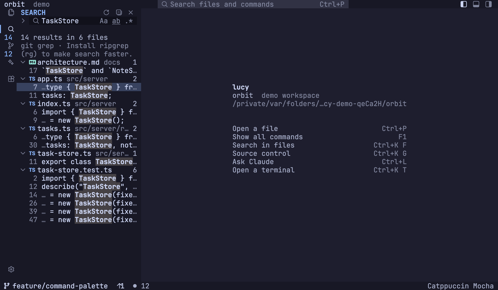

# Lucy Workspace

A terminal-first developer workspace: file explorer, code viewer, project search, source control with
line-by-line diffs and an embedded Claude Code panel, in one TUI. The layout and ease of use of a
modern IDE, with the speed and flexibility of the terminal.


> Status: early development. The core workflow works; see the documents below for what is and is not
> built yet.

## Features

- **Explorer** with lazy loading, Git decorations, create / rename / delete with undo
- **Code viewer** with offline Tree-sitter highlighting, in-file find, Markdown preview; editing is
  handed to your own terminal editor (Micro, Helix, Neovim, Vim)
- **Source control**: staged / changed / untracked groups, stage, unstage, discard, commit, amend,
  branch switching, unified and split diffs with word-level highlights
- **Search**: fuzzy Quick Open and project-wide content search (ripgrep when installed, `git grep`
  or a built-in engine otherwise)
- **Claude Code panel**: your own `claude` CLI in an embedded terminal, with your existing
  authentication and permissions; plus an ordinary shell panel
- **Command palette**, remappable keybindings, settings editor, four themes

| | |
|---|---|
|  |  |

## Requirements

- [Bun](https://bun.sh) 1.3.5 or newer, Git, and a terminal with truecolor support
- Optional: ripgrep, the Claude Code CLI, a terminal editor, a Nerd Font for icons

## Getting started

```sh
bun install
bun run dev -- .      # open the current folder
bun run demo          # open a throwaway demo project
```

To get a `lucy` command on your PATH, run `bun link` in this directory, then `lucy .` anywhere.

## Keys

| Action | Keys |
|---|---|
| Quick Open | `Ctrl+P` |
| Command palette | `Ctrl+Shift+P` or `F1` |
| Toggle sidebar | `Ctrl+B` |
| Explorer / Search / Source Control | `Ctrl+K E` / `Ctrl+K F` / `Ctrl+K G` |
| AI panel | `Ctrl+L` |
| Terminal | `Ctrl+K T` |
| Leave an embedded terminal | `Ctrl+\` |
| Quit | `Ctrl+Q` |

Every binding can be changed in the Keyboard Shortcuts editor (`Ctrl+K Ctrl+S`).

## Development

```sh
bun test              # tests
bun run typecheck     # TypeScript
bun run lint          # Biome
bun run screenshots   # render the UI scenarios to docs/screenshots/
```

## Documentation

- [Architecture](docs/ARCHITECTURE.md)
- [Design system](docs/DESIGN_SYSTEM.md)
- [Security model](docs/SECURITY.md)
- [Third-party notices](THIRD_PARTY_NOTICES.md)

## License

Not chosen yet; see [docs/LICENSING.md](docs/LICENSING.md).
