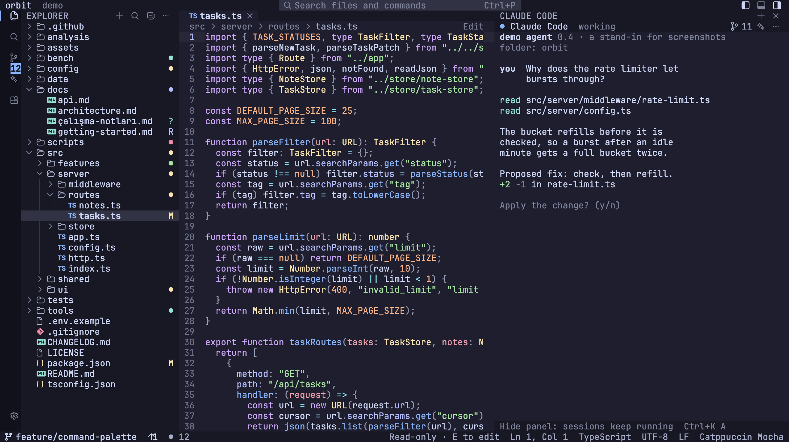
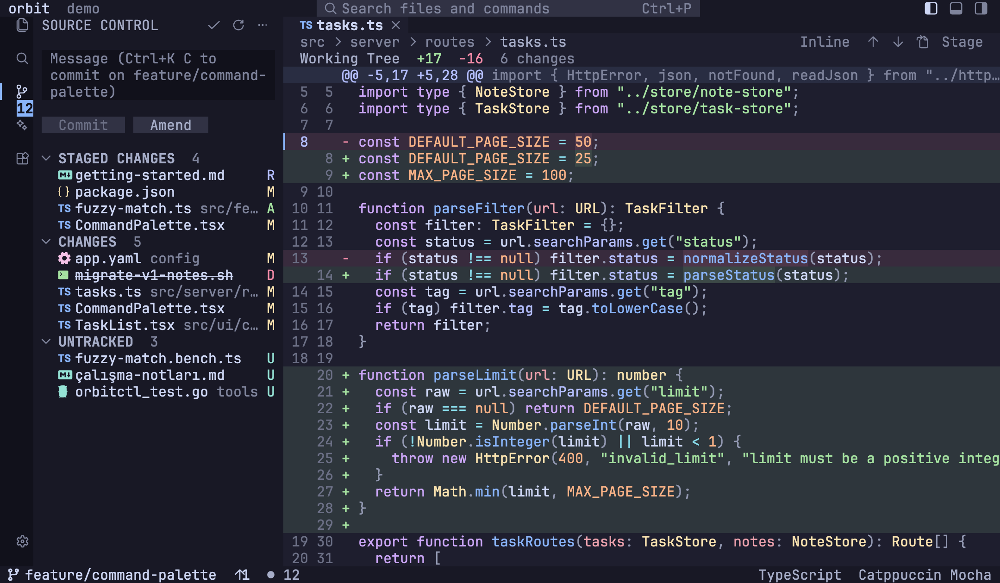
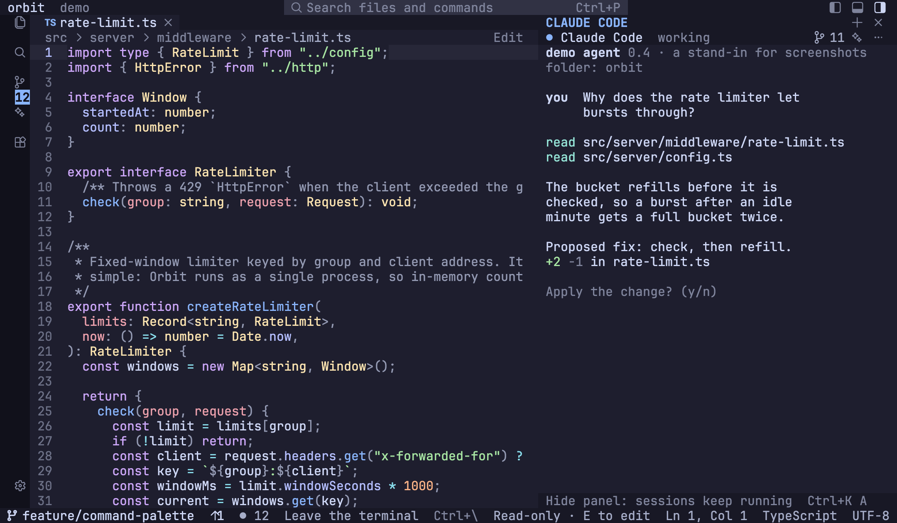
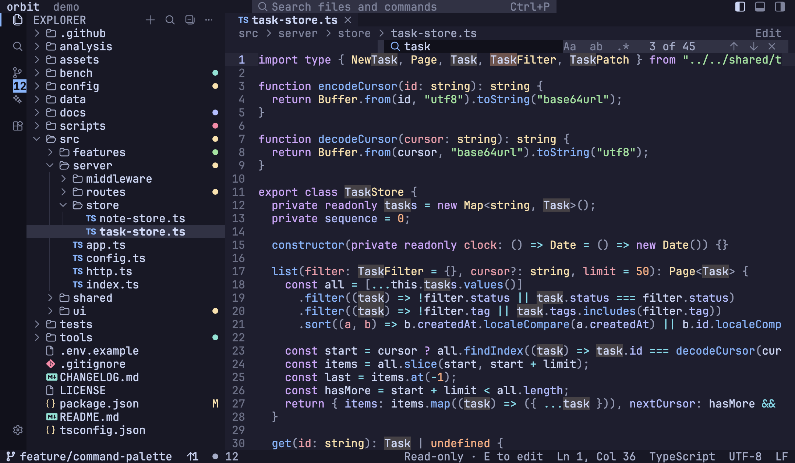
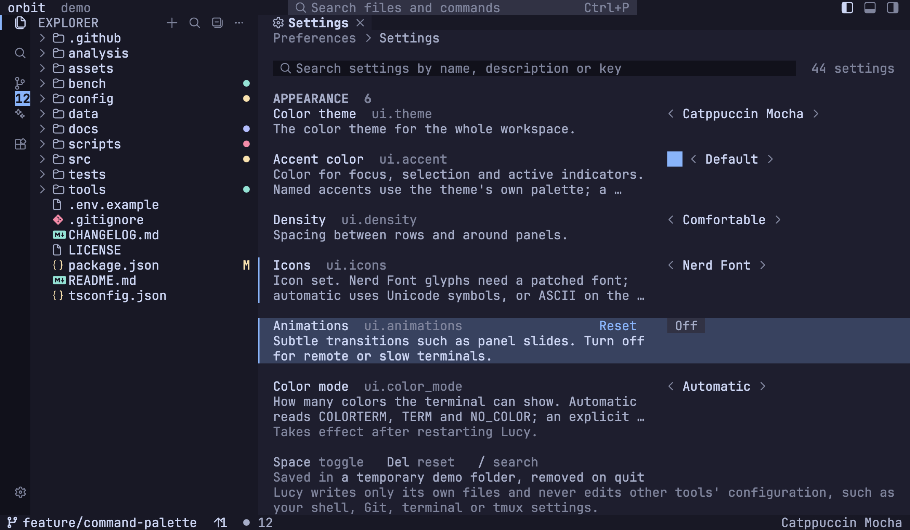

# Lucy Workspace

Lucy Workspace is a local-first developer workspace that runs in your terminal: a file explorer,
code viewer, project search, Source Control with diffs, and an embedded Claude Code panel in one
TUI for macOS and Linux. You start it with `lucy .` in a project folder; it has no server, no
account and no telemetry.



> Status: version 0.1.0, early development. The core workflow works; the lists below say what is
> and is not built yet, and [docs/ROADMAP.md](docs/ROADMAP.md) tracks the rest.

## Features

### Works today

- **Explorer**: lazy-loaded tree with Git decorations, filter, hidden and ignored files on demand,
  create / rename / delete (deletes go to Lucy's own trash and can be undone), copy path.
- **Code viewer**: tabs with preview and pinned tabs, offline Tree-sitter highlighting, find in file
  (plain, case, whole word, regex), go to line, word wrap, Markdown preview, back / forward
  navigation. The viewer is read-only: editing opens the file in your own terminal editor (Micro,
  Helix, Neovim, Vim, nano, vi, or `$VISUAL` / `$EDITOR`).
- **Source Control**: staged / changes / untracked / conflict groups; stage, unstage and discard per
  file or all; commit and amend; switch and create branches; stash and stash pop; fetch, pull and
  push; commit history; unified and split diffs with word-level highlights and next / previous
  change.
- **Search**: fuzzy Quick Open over a file index, and project-wide content search with match case,
  whole word and regex (ripgrep when installed, `git grep` in a repository, a built-in engine
  otherwise).
- **Claude Code panel**: your own `claude` CLI in an embedded terminal, with new, continue, resume,
  restart, rename and close session, a list of past sessions, and prompt templates (explain, review
  diff, write tests) that are pasted, never sent.
- **Terminal panel**: one or more ordinary shells in the bottom panel.
- **Workbench**: command palette, remappable keybindings with a Keyboard Shortcuts editor, Settings
  editor, first-run setup, four themes (Catppuccin Mocha, Tokyo Night, Gruvbox Dark, High
  Contrast) with accent colors, Nerd Font / Unicode / ASCII icons, truecolor / 256 / 16 color
  modes, layouts that adapt to the terminal width, zen mode and a maximized panel, a file watcher,
  restore of open tabs, layout, expanded folders, search query and commit draft per folder.
- **Demo mode**: `lucy --demo` opens a throwaway Git project with isolated settings, optionally in
  the middle of a merge conflict (`--conflict`).

### Not yet

- Editing inside Lucy (there is no editable buffer; files open in an external editor).
- Staging or discarding individual hunks or lines (staging is per file).
- Language servers, diagnostics, go to definition. The "Fix diagnostics" prompt template is listed
  but disabled because there is no diagnostics source.
- A workspace-trust prompt before Git integration starts on an untrusted folder (see
  [docs/SECURITY.md](docs/SECURITY.md)).
- Precise Claude Code status: "working" and "needs attention" are guessed from terminal output.
- Task runner, plugin or theme SDK, remote (SSH/SFTP) files, release packages.
- Linux support exists in the code but has not been tested on Linux.

| | |
|---|---|
|  |  |
|  |  |
|  | |

## Requirements

- macOS or Linux (Linux is untested).
- [Bun](https://bun.sh) 1.3.5 or newer (developed with 1.3.14).
- Git, for Source Control and the fastest file index.
- A terminal with truecolor support. A terminal that speaks the kitty keyboard protocol (Ghostty,
  kitty, WezTerm, foot) unlocks the `Ctrl+Shift` shortcuts.
- Optional: ripgrep (faster content search), the Claude Code CLI (for the AI panel), a terminal
  editor (Micro, Helix, Neovim, Vim, nano), a Nerd Font for icons.

## Install and run

```sh
bun install
bun run dev -- .      # open the current folder
bun run demo          # open a throwaway demo project
```

To get a `lucy` command on your `PATH`, run `bun link` in this directory, then `lucy .` in any
folder. The command is `bin/lucy`, which loads `src/main.ts`.

```text
lucy [path] [--demo] [--conflict] [--no-restore] [--debug] [--help] [--version]
```

`--no-restore` ignores the saved tabs and layout for the folder; `--debug` writes a verbose log and
enables the debug console.

## Keys

| Action | Keys |
|---|---|
| Quick Open | `Ctrl+P` |
| Command palette | `F1`, `Ctrl+Shift+P`, `Ctrl+\ P` |
| Explorer / Search / Source Control | `Ctrl+K E` / `F` / `G`, `Ctrl+Shift+E` / `F` / `G`, `Ctrl+\ E` / `F` / `G` |
| Toggle sidebar / bottom panel | `Ctrl+B` / `Ctrl+J` |
| Toggle the Claude Code panel / focus it | `Ctrl+K A` or `Ctrl+Shift+A` / `Ctrl+L` or `Ctrl+\ A` |
| New Claude Code session / continue / resume | `Ctrl+K N` or `Ctrl+\ N` / `Ctrl+K Ctrl+N` / `Ctrl+K Shift+N` |
| Insert a prompt template | `Ctrl+K I` (outside Source Control), `Ctrl+\ I` |
| Toggle terminal / new terminal | `Ctrl+K T`, ``Ctrl+` ``, `Ctrl+\ T` / `Ctrl+K Shift+T` |
| Move focus between parts | `Ctrl+K` + arrow, `Ctrl+\` + `H` `J` `K` `L`, `F6` / `Shift+F6` |
| Find in file / next / previous / go to line | `Ctrl+F` / `F3` / `Shift+F3` / `Ctrl+G` |
| Close tab / next tab / previous tab | `Ctrl+W` / `Ctrl+PageDown` / `Ctrl+PageUp` |
| Open the file in your editor | `E` or `Ctrl+K O` |
| Stage / unstage / discard (Source Control) | `Ctrl+K S` / `Ctrl+K U` / `Ctrl+K D` |
| Commit | `Ctrl+Enter` in the message box, `Ctrl+K C` |
| Next / previous change in a diff, unified or split | `F7` / `Shift+F7`, `Ctrl+K V` |
| Switch branch / commit history | `Ctrl+K B` / `Ctrl+K H` |
| Settings / Keyboard Shortcuts / theme | `Ctrl+,` or `Ctrl+K ,` / `Ctrl+K Ctrl+S` or `Ctrl+K K` / `Ctrl+K Ctrl+T` |
| Zen mode / maximize panel | `Ctrl+K Z` / `Ctrl+K M` |
| Quit | `Ctrl+Q`, `Ctrl+K Q`, `Ctrl+\ Q` |

`Ctrl+K X` means press `Ctrl+K`, release, then press `X`. The explorer, search and Source Control
views have more keys of their own; the command palette shows every command with its keys.

**Terminals.** `Ctrl+Shift+letter` (and ``Ctrl+` ``, `Ctrl+Enter`) need a terminal that speaks the
kitty keyboard protocol, such as Ghostty, kitty, WezTerm or foot; other terminals cannot send them.
Every such command also has a `Ctrl+K` sequence that works in any terminal. Inside an embedded
terminal (a shell or Claude Code), keys go to the program running there, so `Ctrl+P`, `Ctrl+R`,
`Ctrl+C`, `Escape` and `Tab` behave as usual. The way out is the leader `Ctrl+\` followed by one
key (`P` palette, `H` `J` `K` `L` focus, `E` `F` `G` views, `A` Claude Code, `T` terminal, `Q`
quit); pressing `Ctrl+\` twice sends it to the program. `F1`, `F6` / `Shift+F6` and the kitty-only
shortcuts above also keep working inside a terminal.

## Configuration

Settings live in `config.toml` in Lucy's config directory: `$LUCY_CONFIG_DIR`, else
`$XDG_CONFIG_HOME/lucy`, else `~/.config/lucy` (also on macOS). The file is created only when you
change a setting; a backup is kept on every write. Per-folder state goes to `~/.local/state/lucy`
(`$LUCY_STATE_DIR`) and caches to `~/.cache/lucy` (`$LUCY_CACHE_DIR`).

- **Settings editor** (`Ctrl+,`): every setting with its description and default; problems in
  `config.toml` are listed there. "Open Settings File" opens `config.toml` in your editor.
- **Keyboard Shortcuts editor** (`Ctrl+K Ctrl+S`): search commands, record a new chord, reset to
  the default. Overrides are saved under `[keybindings]` in `config.toml`.

Lucy never edits other tools' configuration: not your shell startup files, Git config, terminal,
tmux, Atuin or Claude Code files. Git settings it needs are passed per command.

## How Claude Code is run

The Claude Code panel starts **your own** `claude` executable (found on `PATH`, or the
`ai.executable` setting) in a pseudo-terminal, with the opened folder as working directory and your
environment. It uses your existing login, settings and permission rules. Lucy never sends a prompt
on its own, never answers Claude Code's trust dialog and never adds permission flags; prompt
templates are pasted into the input and you press Enter. Extra arguments in `ai.args` are passed
through unchanged, with a warning if they bypass permissions. Past sessions are listed by reading
Claude Code's local transcript files read-only.

## Architecture

TypeScript on Bun, with [OpenTUI](https://github.com/sst/opentui) (React renderer) for the UI. The
code is layered: `src/core` (config, commands, keybindings, events), `src/adapters` (Git, file
system, search, syntax, PTY, Claude Code, external editors), `src/app` (service container,
workbench, layout, startup), `src/features/*` (explorer, editor, search, source-control, ai,
terminal, settings; each registers its commands, keybindings and views in its `index.ts`) and
`src/ui` (shared components). See [docs/ARCHITECTURE.md](docs/ARCHITECTURE.md) and
[docs/DESIGN_SYSTEM.md](docs/DESIGN_SYSTEM.md).

## Development

```sh
bun test              # tests
bun run typecheck     # TypeScript
bun run lint          # Biome (bun run lint:fix to apply fixes)
bun run check         # all three
bun run screenshots   # render UI scenarios to docs/screenshots/
bun run bench         # performance measurements (docs/PERFORMANCE.md)
```

## Security

Lucy works only on your machine and makes no network connections of its own; network traffic comes
only from Git commands you trigger and from programs you run in its terminals. Every process is
started without a shell, background Git commands run with hardened flags, and Lucy writes only to
its own directories and, on your explicit action, to the opened folder. There is no workspace-trust
prompt yet, and Git filter drivers in an untrusted repository can still run during a background
`git status`. Read [docs/SECURITY.md](docs/SECURITY.md) before opening a repository you do not
trust.

## Credits and license

Lucy is built on Bun, OpenTUI, React, Tree-sitter grammars, smol-toml and zod; their licenses and
attributions are in [THIRD_PARTY_NOTICES.md](THIRD_PARTY_NOTICES.md).

The project license has not been chosen yet. Until it is, no license is granted.
[docs/LICENSING.md](docs/LICENSING.md) compares the options.
